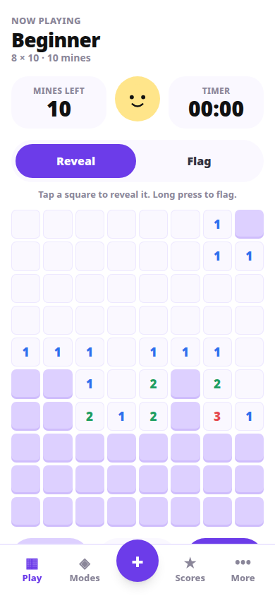

# Minesweeper — The real rules, done properly

Minesweeper is a phone-first Minesweeper prototype with the real rules done properly: mines are placed only after the first tap, the first cell and its neighbours are always safe, with flood reveal, chord tapping, flag mode, long-press flags, and an optional question mark state.

## What it does

- Three difficulties plus a daily board seeded by date.
- A zoom view for dense boards and custom board presets.
- Three hints per game, each costing ten seconds.
- Stats, best times, and history that start at zero and record only real games.

## Status

Working prototype, built November 2026. A signed Android APK of this game also exists.

## Showcase only

This repository is a showcase. It contains no source code and no build files, and nothing here is open source. The screenshot(s) above are showcase images only. See NOTICE.md.

## Contact

Built by Yash Dashrath, Pune, India.

- Email: yashdashrath18@gmail.com
- LinkedIn: https://www.linkedin.com/in/yash-dashrath
- Yash MediaWorks: https://www.linkedin.com/company/yashmediaworks/
